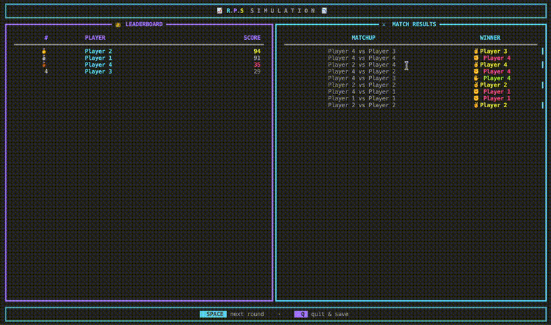

| Rock x Paper x Scissors - Agent-Based Market Simulation |
|:----:|
|  |

# CSE6730 Final Project

## Group 10


--- ;

### Team Members

| Name | Email |
|:-----|:------|
| Denys Chernenko | `dchernenko3@gatech.edu` |
| Smaran Iyer | `siyer358@gatech.edu` |
| Adrian Lozada | `alozada7@gatech.edu` |

--- ;

### 📺 Project Description

In this project, we will implement a **Rock-Paper-Scissors (RPS)** game simulation. The simulation will involve multiple agents playing against each other. There will be two types of agents: **players** and **scalpers**. Players will play against each other. Scalpers will act as intermediaries who profit from discrepancies in card values or high-demand card shortages. The _objective_ of **players** is `to win as much games as possible`. **Scalpers** main _goal_ is to predict the future value of cards and buy and sell them `to make a profit`. In this simulation, cards can be traded for points (the currency of the game). Players and Scalpers can use their points to buy and sell cards. The game will be played in rounds, and at the end of each round, the player that won will receive one point.

### 🕹️ Game Rules

1. Each player starts with a deck of 9 cards, consisting of randomly generated combinations of rock, paper, and scissors. There will be a even number of players.

2. Each round, two players are randomly selected to play against each other.

3. Each player will randomly shuffle their deck and select the top card to play against their opponent. A card can't be reused in the same round, but it can be used in future rounds.

4. The first player to win 3 rounds wins the game. The winner of each round receives one point.

5. After each game, players can use their points to buy new cards from a card market. The card market will have a limited number of cards available, and the price of each card will fluctuate based on supply and demand.

--- ;

### Setup Instructions:

1. Need to have `Python 3.12`.

2. Create a virtual environment.

3. Run the following command from the project's root dir to install the required dependencies:

```bash
pip install .
```

--- ;

### Running the Simulation

| Prompt | Description |
|:-------|:------------|
| Number of players | Must be even |
| Enable scalpers | `y/n` |
| Pairing mode | Random or deterministic `y/n` |
| Step size | Rounds per `SPACE` press |

**Controls during simulation:**

| Key | Action |
|:----|:-------|
| `SPACE` | Advance to next round |
| `🔼` / `🔽` | Adjust parameters on setup screens |
| `Q` | Quit and save results |

Results are saved to `results/` after the session ends.

--- ;

### Project Structure

```txt
cse6730-project/
├── figures/
│   ├── output.gif
│   └── ui.mov
├── INSTRUCTIONS.md
├── pyproject.toml
├── pyrightconfig.json
├── README.md
├── scripts/
│   ├── genWorkTree.sh
│   └── run.sh
├── src/
│   └── cse6730_project/
│       ├── __init__.py
│       ├── agents/
│       │   ├── __init__.py
│       │   ├── base.py
│       │   ├── player.py
│       │   ├── player_onecard.py
│       │   └── scalper.py
│       ├── config.py
│       ├── games/
│       │   ├── __init__.py
│       │   ├── base.py
│       │   └── game_one_card.py
│       ├── main.py
│       ├── market/
│       │   ├── __init__.py
│       │   ├── base.py
│       │   ├── market_common.py
│       │   └── market_simple.py
│       ├── models/
│       │   ├── __init__.py
│       │   └── data_models.py
│       ├── reporting.py
│       ├── simulation/
│       │   ├── __init__.py
│       │   └── simulation.py
│       ├── ui/
│       │   ├── __init__.py
│       │   ├── app.py
│       │   ├── layouts.py
│       │   └── states.py
│       ├── utils.py
│       └── visualization.py
├── temp
├── tests/
│   └── test_simulation.py
└── uv.lock
```

<div align="center">
<sub>CSE 6730 · Modeling & Simulation x Georgia Institute of Technology x Spring 2026</sub>
</div>
